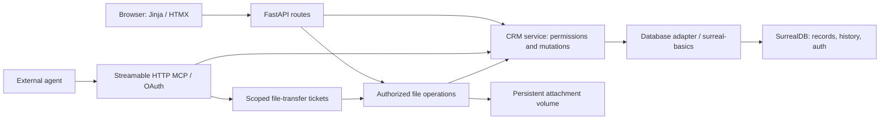

# Architecture and product decisions

Overdrive is one company workspace per installation. It stores sales context and exposes the same operations to people and external agents. It does not run agents or generate proposals, pricing or summaries itself.

## Execution model

The container runs a single Python application. A TLS proxy supplies the public HTTPS origin. Node.js builds frontend assets and runs browser checks; it is not a runtime application server. Dependency and server-version details live in [development](development.md) and [installation](installation.md).

## Domain and visibility

| Record | Meaning and access |
| --- | --- |
| `user`, `unit` | Active users join business units; administrators manage users/units and see all commercial records. |
| `deal` | One opportunity in one unit. An unassigned deal is visible only to admins. A lead is a deal in its initial stage, not a separate entity. |
| `contact`, `organization`, `deal_contact` | Shared identity records. Non-admin contact visibility follows explicit links to accessible deals. Organization visibility follows an accessible deal or an accessible contact's organization; it does not reveal other contacts at that organization. |
| `task`, `note`, `attachment` | Always attached to a deal and inherit its visibility. Tasks have an owner; files and links share the attachment model. |
| `source` | Admin-managed origin catalog used by deals. It is separate from source IDs used by import tools. |
| `audit_event`, `idempotency_request` | Record changes and write receipts. They support history, concurrency control and safe retries. |
| `credential`, `auth_record`, `auth_throttle` | Private authentication state, excluded from generic CRM CRUD and MCP record tools. |
| `proposal_version` | Legacy backup/migration data. New commercial operations use generic files and links. |

Everyone with commercial-record access can edit it. Admin-only operations include user/unit/source management and deal transfer. The system protects the last active administrator and checks that owners can access their deals. Transfer can reassign tasks whose owners would lose access. Removing a user's access requires reassignment of records they own first.

The graph is the access boundary; a shared contact or company is not a new tenancy boundary. Archiving changes active lists but preserves access to historical records. See [usage](usage.md) for the pipeline and task-inbox rules.

## Writes and history

`Actor` carries user identity, channel and client. The service validates models and current permissions before mutation. Commercial changes use optimistic concurrency (`version`) and transactionally store the new record, audit event and optional idempotency receipt. Reusing a key with a different payload is an error; a stale version returns 409. The UI, HTTP API and MCP adapters must preserve these semantics.

The implementation uses explicit audit events and version checks, not SurrealDB temporal diffs as its application history API. The living `deal_so_far` Markdown summary is separate from dated notes and automatic field-change events. No automatic summary generation is included.

Current SurrealDB connections are delegated to surreal-basics, with an application adapter checking all statement results and preventing process-global connection retargeting. See [database](database.md) for migrations and recovery constraints.

## Materials and backup

Attachment metadata and links live in SurrealDB; uploaded bytes live in a filesystem volume under opaque storage keys. “Outdated” is an explicit `deprecated` flag; upload order does not imply a current proposal version. Files and links can be deleted with an audit entry. There is no active first-class proposal workflow and no runtime dependency on Gamma.

Markdown is rendered through a sanitizer; PDF preview uses authorized file routes. Agents obtain short-lived scoped transfer URLs rather than database credentials. Backup archives combine records and checksummed bytes, exclude live auth grants and configuration, and require an empty migrated destination on restore. See [operations](operations.md).

SurrealDB BLOB storage was considered but is not the shipped backend. Do not describe the attachment volume as disposable or claim a database-only export preserves files.

## UI and analytics

The Pitlane design uses compact cards, keyboard shortcuts, inline editing and drawers. The deal cockpit gives the living summary a prominent place, with history, files and relationships in context. Decorative copy rotates from a curated bank; business labels and facts remain stable.

Analytics reconstruct observed stage visits from audit history. Imports may supply incomplete history; the calculator marks gaps instead of inventing stage-entry dates. The fixed pipeline, BRL integer-cent amounts and São Paulo date display are intentional current constraints. See [usage](usage.md) for metric definitions and [the index](README.md) for scope boundaries.
